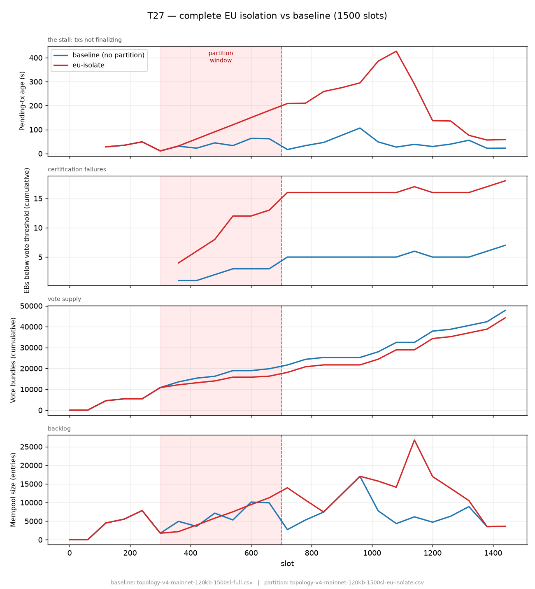

# T27 — Mempool partitioning via network control (Linear Leios, mainnet)

**Threat (per [docs/threat-model.md](https://github.com/input-output-hk/ouroboros-leios/blob/main/docs/threat-model.md)).**
T27 is a transaction-based denial-of-service: an adversary with **network
infrastructure control** segments transaction propagation, giving block
producers **inconsistent mempool views**. Predicted effect — *"conflicting EBs
that don't reach quorum (in time), wasting voting resources"* — i.e. degraded
**throughput** and wasted resources, not a ledger-safety break. Mitigation is
rated **Limited** (the upstream/downstream directional asymmetry), but the doc
notes Linear Leios **prevents conflicting transactions from reaching permanent
storage**, so *"impact is limited to temporary and mostly local resource waste."*

**Finding.** Under an **honest, conflict-free workload**, a complete network
partition produces a **transient liveness stall, not a safety break** —
consistent with the threat model's *"Limited / temporary and local"* rating.
Certification stalls while the cut is open and the chain recovers after it heals,
finalizing ~97.6% of txs, matching the unpartitioned baseline.

The vote-waste half of T27's effect (*"EBs that don't reach quorum, wasting
voting resources"*) **is** exercised — EBs expire below quorum and certification
stalls during the cut — and it recovers; divergent voting does **not** rise
(WrongEB 1,800 vs baseline 5,396). **But see
[Limitations](#limitations--what-this-does-not-test):** the workload was
**conflict-free** (`tx-conflict-fraction = 0`), so the partition had no conflicting
transactions to scatter — the doc's *conflicting-transactions* sub-claim has no raw
material here and is **untested**. The adversary's only action is the partition
itself; nothing is injected.



*Chart `ab-120kb-eu-isolate.png`, drawn from two run logs: baseline
`topology-v4-mainnet-120kb-1500sl-full` and partitioned
`topology-v4-mainnet-120kb-1500sl-eu-isolate` (via their `.csv` parses — see
Reproduce). The source files are also stamped along the bottom of the figure.*

## Setup

| | |
|---|---|
| Topology | `topology-v4-mainnet.yaml` (2685 nodes, 30,414 links), seed 0 |
| Params | `mainnet.yaml` (`linear-with-tx-references`, sequential, 6 shards) + `t27-steady.yaml` |
| Load | 120 kB/s (`tx-generation` 12.5 ms ≈ 80 tx/s), continuous to slot 1500 — **below the certification ceiling** |
| Partition | complete EU isolation (`--isolate`, EU 1052 vs 1633 others), **84,746 edges cut** |
| Window | **slots 300–700** (cut → heal) |
| Slots | 1500 |

The cut is a **network-layer** edge drop (a `partition-scenarios` overlay), not
adversarial node behaviour — it drops all traffic across the boundary in both
directions, the faithful reproduction of "network control."

## Result

| metric (final) | baseline (`full`) | EU-isolated |
|---|---|---|
| **txs finalized** | 112,560 / 115,200 (97.7%) | **112,412 / 115,200 (97.6%)** |
| txs referenced by an endorsement | 110,280 | 110,072 |
| **WrongEB votes** (divergent voting) | 5,396 | **1,800** (not elevated) |
| **redundant EB references** (conflicting-EB signal) | 0 (0.000%) | **18 (0.016%)** |
| EBs below vote threshold | 6 / 64 | 17 / 64 |
| pending-tx age, end | 16.5 s | 68.5 s (off a 427 s peak) |
| mempool, end | ~3.6k | ~3.6k (drained, off a ~27k peak) |

For this honest workload the two T27-defining signals stay benign: WrongEB is
*lower* than baseline (divergent voting tracks block-production activity, which
the cut reduces), and only 18 txs (0.016%) end up referenced by more than one
endorsed EB. Final throughput is within 0.1% of baseline; the partition's cost is
a **transient**, not a permanent loss. **Caveat:** the workload ran with
`tx-conflict-fraction = 0`, so the near-zero redundant-reference rate largely
reflects an input with little to conflict over — it is *not* a measurement of how
the protocol handles a **mempool that actually carries conflicting transactions**
under the partition (see Limitations).

## Why no conflicting EBs were finalized here

Two reasons, and it matters which is which. **(1) By design:** during the cut
neither side holds the stake quorum, so *nothing* certifies until the network
reunites — no EB is finalized, conflicting or not, and inconsistency is confined
to *uncertified* EBs that expire harmlessly. This is the threat model's stated
mitigation (*"Linear Leios prevents conflicting transactions from reaching
permanent storage"*) working as intended. **(2) By construction of the test:** the
workload had essentially no conflicting transactions, so even the *uncertified*
EBs on each side were not materially in conflict. Reason (1) is a genuine protocol
property; reason (2) is a limitation of this experiment — T27's
conflicting-transactions effect only has raw material when the **background
workload** carries conflicts (`tx-conflict-fraction > 0`); here it was zero. That's
a workload-realism gap, not an extra adversarial step (the adversary only
partitions). See Limitations.

## Behaviour over time — the throughput dip

`missing_txs` (referenced txs a node still needs to vote) stays at **0**
throughout. Backlog builds during the cut, peaks ~400 slots after the heal, then
drains:

```
            slot   mempool   pending_age   EBs<thr
 cut 299 →   300     1,759       11 s         —
            480     5,790       91 s          8
            600     9,446      150 s         12
heal 700 →  720    13,966      209 s         16
           1080    14,104      427 s ← peak  16
           1140    26,796      290 s ← peak  17
           1320    10,520       76 s         16
           1380     3,518       56 s         17   ← drained
           1440     3,600       69 s         17
```

**During the cut, certification stops.** Endorsements flatline from ~slot 420 to
the heal, and EBs pile up below quorum (`EBs<thr` 4 → 16). Cause: quorum is
**stake-weighted** (`top-stake-fraction`, `quorum-weight-fraction` 0.75; each
voter's weight = its stake) and the threshold is computed from the **whole**
network and fixed — so when the cut removes enough stake that **neither side
holds 75%**, nothing certifies until the network reunites. This is the
"throughput waste" T27 predicts, expressed as a clean stall.

**After the heal, certification resumes** and drains the backlog. The drain rate
is capped by the **certification ceiling** (`rb-generation-probability 0.05`;
"38 of 64 EBs expired before reaching an RB"), so recovery takes ~680 slots —
recovery time ≫ partition duration, but it completes and returns to baseline.

## Why a *complete* partition is required

A `set-to-set` EU↔NA cut barely registers — it leaves ~712 other-region bridge
nodes intact and gossip reroutes around it (≈0.3% vote dip). To exercise T27 you
must sever the group from **everyone** (`--isolate`), producing a true
bipartition (84,746 edges vs the leaky cut's 53,744). See
[eu-na-partition-run.md](eu-na-partition-run.md).

## Load regime — why 120 kB/s, not the default 200 kB/s

The default mainnet load is **200 kB/s**, but at that rate the chain is already
backlogged *before* any partition: the offered load exceeds the **certification
ceiling** — the rate at which EBs can be certified given `rb-generation-probability
0.05` (~1 ranking block per 20 slots). So we use **120 kB/s**, below the ceiling,
putting the baseline in true steady state. Otherwise you can't separate
"partition damage" from "an overloaded chain that can't drain any backlog."

This is **not network saturation**: link delivery is **100%** in every run
(TX/EB/Vote all received). The limit is Leios **certification throughput**, not
network bandwidth.

## Variant note

The result holds for **both** Linear Leios variants — `linear` (tx bodies inline)
and `linear-with-tx-references` (EB references txs by hash). Both stall during
the cut and recover after heal to the same finalization; the
`leios-variant-linear` (raw log retained internally)
control matches the references run above.

## Limitations — what this does *not* test

T27's only adversarial action is the **network partition** — nothing is produced
or injected. This run models that action and **corroborates the "Limited /
temporary and local" rating for a conflict-free workload** (single complete
partition). T27's predicted "conflicting EBs" effect has two halves, tested
unequally:

- **Vote-waste half — tested.** *"EBs that don't reach quorum, wasting voting
  resources"* needs no double-spends, just divergent mempool views. The run shows
  it: EBs below threshold climb (17/64 vs 6/64 baseline), 38/64 EBs expire before
  reaching an RB, certification stalls during the cut — then recovers.
- **Conflicting-transactions half — untested for lack of raw material.** The
  workload ran with `tx-conflict-fraction = 0`, so the mempool held no conflicting
  txs for the partition to scatter onto opposite sides. `0.016%` redundant
  references therefore reflects a near-conflict-free *input*, not demonstrated
  resistance. Conflicts are a **background-workload property** (real mempools carry
  replacements / double-spend attempts), modelled by `tx-conflict-fraction` —
  turning it up does *not* add an adversarial step; the adversary still only
  partitions.
- **A complete bipartition may not be the worst case for vote-splitting.** A
  complete cut is needed to disrupt propagation at all (a `set-to-set` cut reroutes
  around — see "Why a complete partition is required"), but cutting *all* edges
  also lowers each side's stake and block production, which is *why* WrongEB falls
  vs baseline. A partial cut that keeps **both sides productive on divergent
  mempools**, timed around EB production, could stress the vote-waste effect
  harder; untested.
- **No sustained or repeated partitioning.** "Transient" is a property of a fixed
  400-slot window. A longer or recurring cut could turn the stall effectively
  permanent; untested.
- **Single seed, single topology.** seed 0, one topology — no statistical
  confidence or sensitivity analysis.
- **Recovery is contingent on a simulator fix.** An earlier run's "does not
  recover" result was a simulator gap (the EB-tx fetch — `RequestEBTxs`/`EBTxs` —
  was `unreachable!()`); with it fixed, the partition recovers. Recovery here
  assumes that fix faithfully models the real node's `LeiosFetch`; not validated
  against the Haskell implementation.

A fuller test of T27 would add: (a) a realistic **background** conflict rate
(`tx-conflict-fraction > 0`) so the partition has conflicting txs to scatter — a
workload change, not an attack step, (b) a partial partition that keeps both sides
producing, (c) sustained/repeated cuts, and (d) multiple seeds.

## Reproduce (pipeline)

The simulator (`sim-rs`) and the pseudo-mainnet topology live in this repo
(`leios-tools`); the T27 overlays, the partition-generation and analysis scripts
and the logs are internal tooling (not published). The pipeline, in outline:

1. **Generate the partition** — an internal generator
   (`gen-partition.py`) cuts the EU out of the pseudo-mainnet topology for a
   slot window (300–700), producing the `eu-isolate` overlay.
2. **Run the simulator** — `sim-rs` over the pseudo-mainnet topology
   (`-s 1500` slots) with the `mainnet` base parameters, the T27 steady-state
   overlay (`t27-steady.yaml`, 120 kB/s), and (for the attack run) the
   `eu-isolate` overlay on top; a second, unpartitioned run of the same config
   provides the baseline. The two logs feed the A/B chart.
3. **Analyze** — an internal `analyze.py` parses each log into per-slot CSVs;
   `plot.py` renders the 4-panel A/B chart (the source CSVs are stamped onto
   the figure footer).
