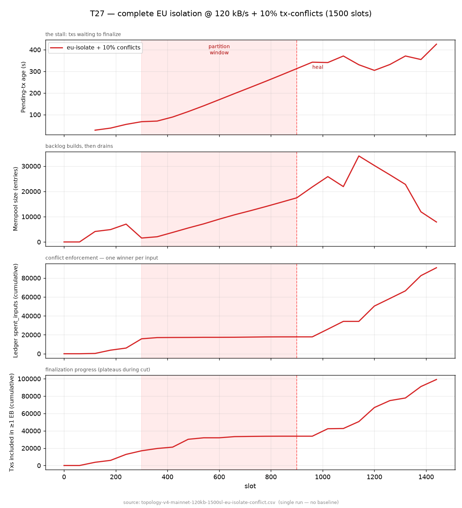

# T27 — complete EU isolation with a conflicting-tx workload (120 kB/s, mainnet)

**Threat (per [docs/threat-model.md](https://github.com/input-output-hk/ouroboros-leios/blob/main/docs/threat-model.md)).**
T27 *"Mempool partitioning via network control"* predicts *"conflicting EBs that
don't reach quorum, wasting voting resources,"* with the mitigation that Linear
Leios *"prevents conflicting transactions from reaching permanent storage,"*
limiting impact to *"temporary and mostly local resource waste."*

**Why this run.** Every prior T27 run used a **conflict-free** workload
(`tx-conflict-fraction = 0`), so the *"conflicting transactions"* half of the
claim had no raw material and went untested (see
[CONCLUSION.md](CONCLUSION.md)). This run repeats the complete EU isolation with a
**10% background conflict rate** (`t27-conflict.yaml`) so the partition has
genuine double-spends to scatter across the cut.

**Finding.** Linear Leios **blocks double-spends from permanent storage — "only
one succeeds" holds, even under a complete partition.** Redundant EB references
stay **0.000%** with 10% conflicts, the ledger's `spent_inputs` set grows
monotonically (one winner per input), and finalization equals the *finalizable
maximum* (≈ offered − losers). The cost is exactly the predicted **processing
waste**: the ~10% loser txs never finalize, so they sit in the mempool and inflate
pending-tx age. The partition does **not** turn conflicts into a safety break or
into finalized conflicting EBs — it adds its transient stall on top. This closes
the conflicting-transactions half of T27.

*Single-run trajectory. Source log `topology-v4-mainnet-120kb-1500sl-eu-isolate-conflict`,
parsed by `analyze.py`, drawn by `plot_single.py`.*

## Setup

| | |
|---|---|
| Topology | `topology-v4-mainnet.yaml` (2685 nodes, 30,414 links), seed 0 |
| Params | `mainnet.yaml` + `t27-steady.yaml` (120 kB/s) **+ `t27-conflict.yaml` (`tx-conflict-fraction: 0.10`)** |
| Load | 120 kB/s, 115,200 txs offered; **~10% are double-spends** of a recent input |
| Partition | complete EU isolation (`--isolate`), **84,746 edges cut** |
| Window | **slots 300–900** (cut → heal; 600 slots) |
| Variant | `linear-with-tx-references` with the EB-tx fetch fix (TX received 120.7%, the `EBTxs` convention) |
| Slots | 1500 |

## Result (final)

| metric | conflict-free (300–700)¹ | **conflict 0.10 (300–900)** |
|---|---|---|
| txs in ≥1 EB | ~99% | **102,620 / 115,200 (89.1%)** |
| txs referenced by an endorsement | 110,072 | **96,560 (83.8%, 144.84 MB)** |
| txs directly in a Praos block | — | 2,358 (3.54 MB) |
| **effective finalization** | 97.6% | **~85.9%** (endorsed + direct) |
| **redundant EB references** (conflicting-EB signal) | 0.016% | **0 (0.000%)** |
| **ledger `spent_inputs`** (conflict enforcement) | n/a | **90,844** |
| WrongEB (divergent voting) | 1,800 | **1,800** (unchanged) |
| EBs below vote threshold | 17 / 64 | 22 / 64 |
| EBs expired before reaching an RB | 38 / 64 | 41 / 64 |
| pending-tx age, end | 68.5 s | **539.2 s** |
| mempool, end | ~3.6k | 7.9k (draining, off a ~34k peak) |

¹ [network-partition.md](network-partition.md) — different window (see Limitations); shown for orientation, **not** a clean A/B.

## What this proves — "only one succeeds"

Three independent signals agree that conflicting transactions do **not** both
reach permanent storage, during *or* after the cut:

1. **`spent_inputs` is a monotonic set** → 90,844 by end. An input cannot be
   consumed twice; the ledger enforces it.
2. **Redundant EB references stay 0.000%** even with 10% conflicts — no tx is
   finalized via two endorsed EBs.
3. **Finalization equals the finalizable maximum.** With ~10% double-spend losers,
   ≈ 11,520 txs *cannot* finalize by construction, so max-finalizable ≈ 103,680 —
   and `in_eb` = 102,620 is **~99% of that**. Essentially every non-loser tx was
   finalized; exactly one of each conflicting pair won, the rest were dropped.

So the finalization "drop" vs the conflict-free run is **not** protocol failure —
it is the structurally-unfinalizable double-spend losers being correctly rejected.

## The cost is processing waste (T26's predicted effect)

The ~10% loser txs never finalize, so they linger in the mempool/pending pool.
That is what drives **pending-tx age to 539 s** (vs 68.5 s conflict-free) and
bloats the mempool — dead-weight resource waste, *"temporary and mostly local,"*
not a safety break.

## The partition does not amplify conflicts into a safety problem

The cut scatters conflicting txs onto divergent mempools, but after heal the
ledger still resolves one winner per input (**0% redundant**). `WrongEB` is
**unchanged at 1,800** — conflicts did not raise divergent voting. During the cut,
certification freezes (txs-in-EB and `spent_inputs` both plateau ~slot 360→900),
then resume after heal — the same transient-stall shape as the conflict-free run,
with conflict losers added as backlog.

## Limitations — what this does *not* establish

- **Window confound — not a clean A/B.** This run used the **300–900** overlay,
  but the primary conflict-free finding used **300–700**. So the *magnitude* of the
  finalization drop / pending-age rise conflates conflicts, the longer cut, and
  incomplete drain at run-end. The **qualitative** result (only-one-succeeds, 0%
  redundant, finalized ≈ finalizable-max) is window-independent and solid; a clean
  quantitative A/B needs conflict-vs-no-conflict at the **same** window and seed.
  (The only same-window 300–900 conflict-free run is the superseded buggy one, so
  it can't serve as the baseline.)
- **No explicit "double-spends finalized: 0" counter** — the proof is indirect
  (spent_inputs set + 0% redundant + finalized ≈ finalizable-max). Strong, but inferred.
- **0.10 is a stress rate** — realistic mainnet background is ~0.01–0.02; more
  conflicts → proportionally more loser dead-weight.
- **Single seed; partial recovery at run-end** (mempool draining 34k→7.9k, age
  still elevated) — driven by the 600-slot window + loser dead-weight, not a
  non-recovery.
- This is a **simulator** result under an idealized conflict model (single integer
  input per tx, no scripts/collateral). Real-ledger conflict semantics are
  inherited from the existing Cardano ledger and would be confirmed against real
  Haskell Leios nodes (see [CONCLUSION.md](CONCLUSION.md) triage).

## Reproduce (pipeline)

As for the conflict-free run ([`network-partition.md`](network-partition.md)):
the simulator (`sim-rs`) and the pseudo-mainnet topology live in this repo
(`leios-tools`); the T27 overlays, the partition generator and the analysis
scripts are internal tooling (not published). In outline: run `sim-rs` (1500
slots) over the pseudo-mainnet topology with the `mainnet` base parameters
stacked with the steady-state overlay (`t27-steady.yaml`, 120 kB/s), the 10%
conflict overlay (`t27-conflict.yaml`) and the EU-isolate partition overlay
(window 300–900); parse the log to a per-slot CSV and plot the single-run chart
(pending age, mempool, spent inputs, txs-in-EB panels, window 300–900).

To remove the window confound, run conflict=0 and conflict=0.10 at the **same**
window (regenerate the partition overlay with matching start/stop slots) and the
same seed, then A/B them.

