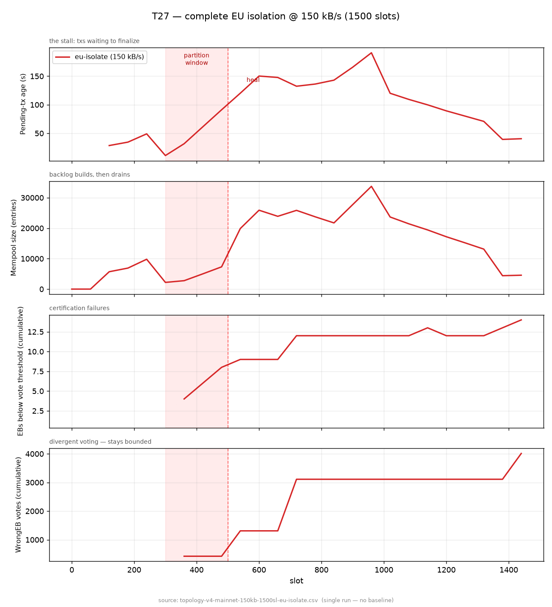

# T27 — complete EU isolation at high load (150 kB/s, Linear Leios, mainnet)

**Threat (per [docs/threat-model.md](https://github.com/input-output-hk/ouroboros-leios/blob/main/docs/threat-model.md)).**
T27 is a transaction-based denial-of-service: an adversary with **network
infrastructure control** segments transaction propagation, giving block
producers **inconsistent mempool views** and (predicted) *"conflicting EBs that
don't reach quorum, wasting voting resources."* Mitigation is rated **Limited**,
but the doc notes Linear Leios **prevents conflicting transactions from reaching
permanent storage**, so *"impact is limited to temporary and mostly local
resource waste."*

**Finding.** This run repeats the complete-EU-isolation experiment at a **higher
offered load (150 kB/s)** and a **shorter, earlier cut (slots 300–500)**, and is
consistent with the [120 kB/s result](network-partition.md). Under this
**honest, conflict-free workload**, the failure mode is a **transient liveness
stall, not a safety break**: backlog builds during the cut, peaks ~460 slots
after the heal, then drains, and the chain reaches **~97.7% effective
finalization**. The vote-waste half of T27's effect (*"EBs that don't reach
quorum, wasting voting resources"*) **is** exercised — EBs expire below quorum and
certification stalls during the cut — and it recovers. But the workload was
**conflict-free** (`tx-conflict-fraction = 0`), so the partition had no conflicting
transactions to scatter; the doc's *conflicting-transactions* sub-claim has no raw
material here and is **untested** (see **Limitations**). The adversary's only
action is the partition itself — nothing is injected. At this load
the chain also sits **at/above its certification ceiling**, so part of the
backlog is chain saturation, not partition damage (the caveat baked into
`t27-150kb.yaml`).



*Single-run trajectory (no baseline at this load — see Note). Source log
`topology-v4-mainnet-150kb-1500sl-eu-isolate`, parsed by `analyze.py` and drawn
by `plot_single.py`.*

## Setup

| | |
|---|---|
| Topology | `topology-v4-mainnet.yaml` (2685 nodes, 30,414 links), seed 0 |
| Params | `mainnet.yaml` (`linear-with-tx-references`, sequential, 6 shards) + `t27-150kb.yaml` |
| Load | 150 kB/s (≈96 tx/s), continuous — **144,000 txs offered** over 1500 slots |
| Partition | complete EU isolation (`--isolate`, EU vs others), **84,746 edges cut** |
| Window | **slots 300–500** (cut → heal; 200 slots) |
| Variant | `linear-with-tx-references` **with the EB-tx fetch fix** (`RequestEBTxs`/`EBTxs`) |
| Slots | 1500 |

The cut is a **network-layer** edge drop (a `partition-scenarios` overlay), not
adversarial node behaviour — it severs all traffic across the EU boundary in
both directions, the faithful reproduction of "network control." TX received is
106.6% (the `EBTxs`-delivered-body convention), EB and Vote both 100% — i.e. the
tx-fetch fix is active, so references behaves like the inline variant.

## Result (final)

| metric | EU-isolated @ 150 kB/s |
|---|---|
| txs included in ≥1 EB | **142,558 / 144,000 (99.0%)** |
| txs referenced by a Leios endorsement | 138,340 (96.1%, 207.51 MB) |
| txs directly in a Praos block | 2,280 (3.42 MB) |
| **effective finalization** (endorsed + direct) | **~140,620 / 144,000 (~97.7%)** |
| **redundant EB references** (conflicting-EB signal) | **0 (0.000%)** |
| **WrongEB votes** (divergent voting) | 4,012 (+ `LateRBHeader` 902) |
| EBs below vote threshold | 13 / 64 |
| EBs expired before reaching an RB | 36 / 64 |
| L1 blocks with a Leios endorsement | 23 |
| pending-tx age, end | 42.4 s (off a 191.0 s peak) |
| mempool (node 0), end | ~4,560 (drained, off a ~33,722 peak) |
| avg tx → EB / tx → block | 91.0 s / 170.2 s |

For this honest workload the two T27-defining signals stay benign: redundant
references are **0.000%** (no tx ends up referenced by more than one endorsed EB),
and `WrongEB` (4,012) tracks the higher block-production/voting volume at this
load rather than partition-induced divergence. Effective finalization is within
~0.1 pp of the 120 kB/s run. **Caveat:** the workload had `tx-conflict-fraction =
0`, so a 0.000% redundant-reference rate largely reflects an input with nothing to
conflict over — it is *not* a measurement of how the protocol handles a **mempool
that actually carries conflicting transactions** under the partition (see
**Limitations**).

## Behaviour over time — the throughput dip

```
            slot   mempool(n0)   pending_age   EBs<thr   WrongEB
 cut 300 →   300       2,200        11.0 s        —         —
            480        7,307        91.1 s         8        424
heal 500 →  540       19,888       120.2 s         9      1,310
            600       25,888       150.2 s         9      1,310
            900       27,722       165.7 s        12      3,111
            960       33,722 ←peak 191.0 s ←peak  12      3,111
           1080       21,422       109.3 s        12      3,111
           1320       13,122        70.9 s        12      3,111
           1380        4,398       39.3 s ←drained 13     3,111
 end       1440        4,560        40.5 s        14      4,012
```

Backlog builds through the cut, **peaks ~460 slots after the heal** (mempool
~33.7k *and* pending age 191 s both around slot 960), then **drains** back to
~4.5k entries / ~40 s by slot 1380. `WrongEB` and `EBs<threshold` step up during
the cut and just after, then flatten — they do not keep diverging late in the
run. This is the same **transient dip → recovery** shape as the 120 kB/s run,
just larger because the offered load is higher.

## Why no conflicting EBs were finalized here

Two reasons, and it matters which is which. **(1) By design:** during the cut
neither side holds the 75% stake quorum, so *nothing* certifies until the network
reunites — no EB is finalized, conflicting or not, and inconsistency is confined
to *uncertified* EBs that expire harmlessly (here, 36/64 expired before reaching
an RB). This is the threat model's stated mitigation (*"Linear Leios prevents
conflicting transactions from reaching permanent storage"*) working as intended.
**(2) By construction of the test:** the workload had essentially no conflicting
transactions to begin with, so even the *uncertified* EBs on each side were not
materially in conflict. Reason (1) is a genuine protocol property; reason (2) is a
limitation of this experiment — T27's conflicting-transactions effect only has raw
material when the **background workload** itself carries conflicts
(`tx-conflict-fraction > 0`); here it was zero. That's a workload-realism gap, not
an extra adversarial step (the adversary only partitions). See **Limitations**.

## Load regime — why 150 kB/s also shows chain saturation

At 150 kB/s the chain runs **at or above its certification ceiling** — the rate
EBs can be certified given `rb-generation-probability 0.05` (~1 ranking block per
20 slots). The tell is **36 of 64 EBs (56%) expiring before reaching an RB**: even
without a partition, offered load at this rate outpaces certification. So part of
the backlog here is **chain saturation**, not the cut — the exact reason
`t27-150kb.yaml`'s header recommends `t27-steady.yaml` (120 kB/s, below the
ceiling) when you need to *cleanly separate* partition damage from saturation.
What this run adds is the harder-load confirmation: even with the chain already
near capacity, the partition's contribution is still a **transient** that drains,
and the conflicting-EB / divergent-voting signals stay benign.

This is **not network saturation**: link delivery is 100% for EB and Vote (and
106.6% for TX via the `EBTxs` convention). The limit is Leios **certification
throughput**, not bandwidth.

## Comparison to the 120 kB/s baseline run

| signal | 120 kB/s (`network-partition.md`) | 150 kB/s (this run) |
|---|---|---|
| window | slots 300–700 (400) | slots 300–500 (200) |
| effective finalization | 97.6% | ~97.7% |
| redundant EB references | 0.016% (18 tx) | **0.000% (0 tx)** |
| WrongEB | 1,800 | 4,012 (higher load → more voting) |
| EBs expired before RB | 38 / 64 | 36 / 64 |
| recovers after heal? | yes | yes |

Across both loads and window lengths the honest-load picture is the same:
**transient liveness stall, recovers, no finalized conflicting EBs.** Both runs
share the same scope limits below.

## Limitations — what this does *not* test

T27's only adversarial action is the **network partition** — nothing is produced
or injected. This run (and the 120 kB/s one) models that action and
**corroborates the "Limited / temporary and local" rating for a conflict-free
workload**. T27's predicted "conflicting EBs" effect has two halves, tested
unequally:

- **Vote-waste half — tested.** *"EBs that don't reach quorum, wasting voting
  resources"* needs no double-spends, just divergent mempool views. The runs show
  it: EBs expire below quorum, certification stalls during the cut, then recovers.
- **Conflicting-transactions half — untested for lack of raw material.** The
  workload ran with `tx-conflict-fraction = 0`, so the mempool held no conflicting
  txs for the partition to scatter onto opposite sides. `0.000%` redundant
  references therefore reflects a conflict-free *input*, not demonstrated
  resistance. Note: conflicts are a **background-workload property** (real mempools
  carry replacements / double-spend attempts), modelled by `tx-conflict-fraction`
  — turning it up does *not* add an adversarial step; the adversary still only
  partitions.
- **A complete bipartition may be the *benign* corner for vote-splitting.** Cutting
  *all* cross-boundary edges lowers each side's stake and block production — which
  is *why* `WrongEB` can fall vs baseline. A targeted/partial cut that keeps
  **both sides productive on divergent mempools** (timed around EB production)
  could stress the vote-waste effect harder; untested.
- **No sustained or repeated partitioning.** "Transient" is a property of a fixed
  200–400 slot window. A longer or recurring cut could turn the stall effectively
  permanent; untested.
- **Single seed, single topology.** seed 0, one topology — no statistical
  confidence or sensitivity analysis.
- **Recovery is contingent on a simulator fix.** An earlier run's "does not
  recover" result was a simulator gap (the EB-tx fetch — `RequestEBTxs`/`EBTxs` —
  was `unreachable!()`); with it fixed, the partition recovers. Recovery here
  assumes that fix faithfully models the real node's `LeiosFetch`; not validated
  against the Haskell implementation.
- **150 kB/s conflates partition damage with saturation** (36/64 EBs expire
  pre-RB even absent a cut), so this run is a robustness data point, not a clean
  isolation of the attack — use the 120 kB/s steady run for that.

A fuller test of T27 would add: (a) a realistic **background** conflict rate
(`tx-conflict-fraction > 0`) so the partition has conflicting txs to scatter — a
workload change, not an attack step, (b) a partial partition that keeps both sides
producing, (c) sustained/repeated cuts, and (d) multiple seeds.

## Note — single-run chart (no 150 kB/s baseline)

There is no matching `150kb-full` (no-partition) run in this directory, so the
chart is a **single-run trajectory** drawn by `plot_single.py`, not the 4-panel
A/B that `plot.py` produces for the 120 kB/s pair. The dip→recovery shape is
self-evident from the one series; for a true A/B at this load, generate a
baseline with the same config minus the overlay (see Reproduce).

## Reproduce (pipeline)

As for the 120 kB/s run ([`network-partition.md`](network-partition.md)): the
simulator (`sim-rs`) and the pseudo-mainnet topology live in this repo
(`leios-tools`); the T27 overlays, the partition generator and the analysis
scripts are internal tooling (not published). In outline: generate the EU-isolate
partition overlay for slots 300–500; run `sim-rs` (`-s 1500`) over the
pseudo-mainnet topology with the `mainnet` base parameters, the 150 kB/s overlay
(`t27-150kb.yaml`) and the partition overlay; parse the log to a per-slot CSV and
plot the single-run chart (window 300–500). A matching no-partition baseline at
the same load would give a true A/B, but was not run.
