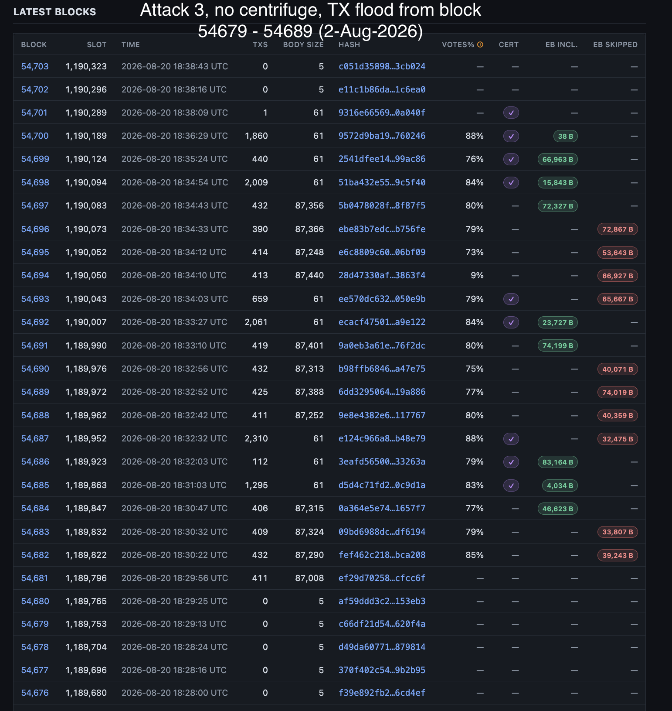
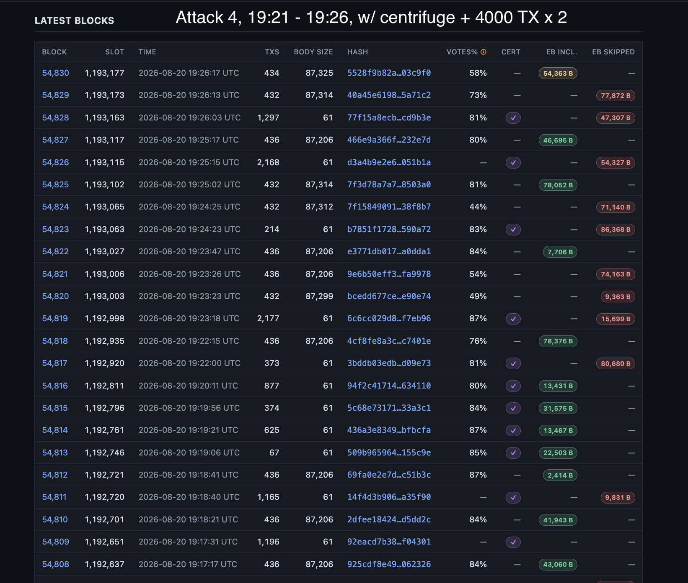

# Transaction Flooding Attack - Updated Report, ver. 1.1.1
Red Team, IO|Labs  
25 August, 2026

## Abstract
Mempool split attack (T27) can effectively stop Endorser Blocks certification, but it requires physical
split of the network. This experiment tries to check, whether we can achieve a similar effect using 
transaction flooding, effectively hurting or even blocking tx submission protocol.

The experiment: using unstaked adversarial Piranha nodes, the Leios Musashi test net was flooded 
with valid transactions (TXs) from two geographically remote points on the network.

<!-- 
during a time when voting 
committee membership was ranging between 75% and 77% (some nodes were not voting; confirmed Red Team PIR0 was voting - don't blame us!).
Just prior to the flood, some transactions were already present
from the centrifuge and Leios Endorser Block (EB) certification was nominal. 
-->

We observed that the additional TX flooding pushed the votes down (by several percent) or even below the 
threshold of 75% and that EB certification was hurt during the period of flooding. 
The moment when EB certification failed, Praos blocks began catching up inclusion of the TXs. Once the attack was
stopped, EB certification eventually resumed. 

This demonstrates that limited, but observable mempool splitting effect may be achieved by non-staked nodes without 
physically harming the connections between nodes. 

<!-- when the voting committee is near the threshold.-->
<!-- --- a situation that should be mitigated by some
means beyond the scope of this experiment (e.g. incentives).-->

<!-- Despite limited effect, this attack may be dangerous in combination with other attacks. -->

## Introduction
The Leios protocol requires that transactions be diffused throughout the network before they can be certified
into an Endorser Block (EB). Two forms of diffusion exist: the forwarding of transactions from one node to
another downstream node and via the fetch transactions request. In either case, the goal is to get transactions
out to all nodes (especially voting nodes) in time for nodes to validate and vote on EBs that contain them.

The main idea is to have nodes on the network with (a) full mempools (no empty space for new txs); 
and (b) having no common transactions, so that Tx Submission protocol can no longer be useful for transaction
distribution.

The transaction (TX) flood attack attempts to push new transactions into the network at a rate that stresses
transaction diffusion. If this can be done from distant (in terms of network span) points in the network, then
there may exist nodes, which do not have all of the TXs referenced by an EB. This could happen if a node
announces an EB with TXs it recently acquired, but those TXs hadn't made it to all nodes yet. In that case, a
voting node might not vote because it can't validate the EB. That would not harm the Praos functionality, but
it could deny the improved performance of Leios.

The cost of the attack is fairly small, only incurring fees during the outage period
induced, but long term sustained denial of EBs seems unlikely. Machine cost is trivial - these attacks
were run on laptops including both the relay node and either cardano-cli or net-rs generators. Magazines
are built and signed in advance so run-time attack mode is cheap.

This attack can be considered a variant of T27 attack: mempool fragmentation, but here we do not use any 
network manipulation,
we manipulate by proper tx submission only. 
This attack was first researched in Piranha network experiment, and this 
direction seemed plausible.

## Experiment (general description)
Two sets of transactions were created using Red Team funded addresses, 
that fan out UTXOs and then recollect them; only fees are lost from the funded address. We call a set of
transactions a "magazine". Two honest Leios prototype Haskell nodes were setup on the Leios Testnet, each
with its own magazine, in two distinct parts of the world (hopefully modeling a large span across the network).
The Haskell nodes were configured as relays and given a small
set of peers in the testnet. The nodes were non block-producing and had no stake.

Two modes of execution were run, with similar results: (a) scripts submitted TXs directly to the Haskell relay
node via the cardano-cli, and (b) net-rs used Leios protocol messages to forward TXs to the relay. In both
cases, the Haskell Leios prototype version w32 did the heavy lifting of TX diffusion to its named and
discovered peers.

Kleioscan was used to monitor TX adoption and EB certification/inclusion. Net-cluster was used to observe forks,
and EB certification.

## Specific experimentation details

There were three experiments conducted: two attacks as described above (two sources along with centrifuge
message production). And one more attack, same setting (two sources), but without centrifuge.

The attack is started when tx submission process is activated, and ends when all transactions are
submitted. However, some additional time is necessary to flush all transactions from mempool to
blocks (post-attack). 

## Raw Results

Attack screenshots (from Kleioscan) are provided, as well as statistics and analysis of the results.
The statistics charts have the following data: 

* average transactions per slot (number of accepted transactions divided by number of slots);

* average vote for accepted blocks in the range;

* number of EBs that were not certified but could be certified ("non-voted" EB); our formal 
  definition: the next Praos block after EB is at least 14 slots later.

### Isolated attack: two sources without centrifuge

| range | range-description | accepted-txs | slot-count | average-txs-per-slot | average-voting % | eb-count | non-voted | non-voted-ratio |
| --- | --- | ---: | ---: | ---: | ---: | ---: | ---: | ---: |
| 54679–54702 | all | 15741 | 570 | 27.6158 | 80.78% | 19 | 3 | 15.79% |
| 54679–54689 | during attack | 6211 | 223 | 27.8520 | 79.67% | 8 | 1 | 12.50% |
| 54690–54702 | after attack | 9530 | 347 | 27.4640 | 81.33% | 11 | 2 | 18.18% |

### Full attack (two sources + centrifuge)

Attack started at block 54583 and ended at block 54592 (inclusive). 

| range | range-description | accepted-txs | slot-count | average-txs-per-slot | average-voting % | eb-count | non-voted | non-voted-ratio |
| --- | --- | ---: | ---: | ---: | ---: | ---: | ---: | ---: |
| 54551–54609 | all | 36627 | 1368 | 26.7741 | 83.87% | 49 | 5 | 10.20% |
| 54551–54582 | before attack | 16445 | 675 | 24.3630 | 84.18% | 24 | 1 | 4.17% |
| 54583–54592 | during attack | 7777 | 235 | 33.0936 | 83.00% | 9 | 2 | 22.22% |
| 54593–54609 | after attack | 12405 | 458 | 27.0852 | 83.78% | 16 | 2 | 12.50% |

### Full attack, again (two source + centrifuge)

Attack started at block 54816 and ended at block 54830 (inclusive). Two magazines of ~4000 messages.

Post-attack duration (15 blocks) is considered equal to the attack duration: we suppose that this time
is necessary to flush attacking transactions from mempool; it's just an empirical observation, based
on similar post-attack period of isolated (two-sources) experiment.

| range | range-description | accepted-txs | slot-count | average-txs-per-slot | average-voting % | eb-count | non-voted | non-voted-ratio |
| --- | --- | ---: | ---: | ---: | ---: | ---: | ---: | ---: |
| 54801–54870 | all | 47887 | 1580 | 30.3082 | 82.97% | 65 | 14 | 21.54% 
| 54801–54815 | before attack | 9745 | 327 | 29.8012 | 85.09% | 14 | 1 | 7.14% 
| 54816–54830 | during attack | 10135 | 421 | 24.0736 | 80.20% | 15 | 4 | 26.67% 
| 54831–54845 | post-attack | 12185 | 326 | 37.3773 | 80.00% | 15 | 7 | 46.67% 
| 54846–54870 | after attack | 15822 | 506 | 31.2688 | 82.91% | 21 | 2 | 9.52% 

## Discussion

As one can see, there is visible but limited influence of the attack on 
block certification rate (share of blocks that didn't have enough votes for certification) 
and average vote (drops by 1-3 percents for certified blocks). 

<!--
During planning, we observed centrifuge activity and coincidentally there were only 75-77% voting committee
member nodes - just enough for quorum.  We took this opportunity to start the attack and even though TX
submission seemed throttled, the effect on the network was immediately obvious. EB certification and inclusion
went to zero for the duration of the attack (approximately 5 minutes). TX adoption continued via Praos with
~430 TXs per ranking block (RB).

After the TX flood completed sending all TXs in the magazines (each of the two finished at slightly different
times), there continued a period of non EB certification but within several minutes it resumed until it went
again to zero because the centrifuge was not active (and we assume that our submitted TXs had all been
included by either RBs or EBs). We verified that the TXs were adopted.
-->

## Conclusion
It seems that for a marginally represented voting committee that leaves the participating voters above 75% by
only 2-3%, the Leios protocol is vulnerable to a TX flood attack that pushes the voting count below the needed
75% quorum threshold and thus denies EB certification. 
This makes mempool fragmentation hypothesis plausible, although the scale of its effect is limited.

While the Praos RB production continues to include the
TXs, the result is temporary loss of the increased bandwidth of Leios. This was only two machines attacking;
there could be higher impact with more machines coordinating an attack from the perimeter of the network.
Also a combination of this attack with other attacks can be dangerous.
