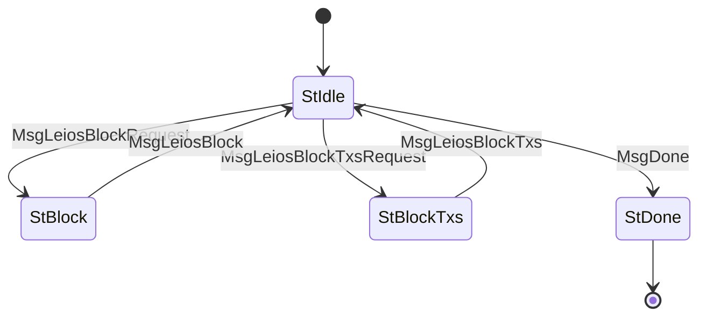

# LeiosFetch (Protocol ID 19) — CIP-0164

Client-driven request/response for Leios data retrieval. Supports fetching individual endorser blocks (EBs) and selective transaction fetching via bitmap addressing. Complements [LeiosNotify](../leios_notify/) which provides the offers.

The codec follows `encodeLeiosFetch` / `decodeLeiosFetch` in [ouroboros-consensus c54515e](https://github.com/IntersectMBO/ouroboros-consensus/blob/c54515e35498e921cbd651a2c19c3360a41d35b8/ouroboros-consensus/src/ouroboros-consensus/LeiosDemoOnlyTestFetch.hs). Vote-fetch and block-range streaming messages are not implemented here.

## Files

| File | Description |
|------|-------------|
| `mod.rs` | State machine (`State`, `Message`), `Protocol` implementation |
| `codec.rs` | CBOR encode/decode for LeiosFetch messages |

**Legend:** CBOR = Concise Binary Object Representation.

## State Machine

## Agency Table

| State | Agency | Message | Next State |
|-------|--------|---------|------------|
| StIdle | **Client** | MsgLeiosBlockRequest(point) | StBlock |
| StIdle | **Client** | MsgLeiosBlockTxsRequest(point, bitmap) | StBlockTxs |
| StIdle | **Client** | MsgDone | StDone |
| StBlock | **Server** | MsgLeiosBlock(block) | StIdle |
| StBlockTxs | **Server** | MsgLeiosBlockTxs(point, bitmap, transactions) | StIdle |
| StDone | Nobody | — | — |

**Legend:** Agency = the side allowed to send the next message; `St` and `Msg` are the state and message prefixes used in the Rust enums. `point` identifies an endorser block by slot and hash; `bitmap` selects transactions. The transaction response echoes the requested point and bitmap.

## Wire Format

| Message | CBOR array |
|---------|------------|
| MsgDone | `[0]` |
| MsgLeiosBlockRequest | `[1, point]` |
| MsgLeiosBlock | `[2, block]` |
| MsgLeiosBlockTxsRequest | `[3, point, bitmaps]` |
| MsgLeiosBlockTxs | `[4, point, bitmaps, transactions]` |

**Legend:** CBOR = Concise Binary Object Representation; `point` = `[slot, hash32]`, where `hash32` is a 32-byte hash; `block` = the endorser-block manifest map `{tx_hash => tx_size}` (transaction hash to transaction size); `bitmaps` = the transaction selection map described below; `transactions` = a list of transaction bodies. Block manifests and transaction bodies retain their raw CBOR bytes for the consumer to interpret.

Exact message-tag tests use byte vectors derived from the Haskell encoder.

## Limits

These are the limits enforced by this Rust implementation:

- **Max message size**: 65,535 bytes (idle), 25,165,824 bytes (data states, 24 MiB)
- **Ingress limit**: 25,165,824 bytes (24 MiB)
- **Max endorser-block manifest size**: 16,777,216 bytes (16 MiB)
- **Max individual transaction size**: 65,536 bytes (64 KiB)
- **Max bitmap entries**: 1,024
- **Max transactions**: 65,536
- **Timeout**: server states 120s (large transfers)

## Bitmap TX Addressing

`MsgLeiosBlockTxsRequest` carries a `BTreeMap<u16, u64>` bitmap for selective transaction fetching. Each entry maps a 16-bit segment index to a 64-bit bitmask, allowing the client to request specific transactions from an EB without downloading the entire set. This is critical for bandwidth efficiency when a node already has most transactions from prior dissemination.
