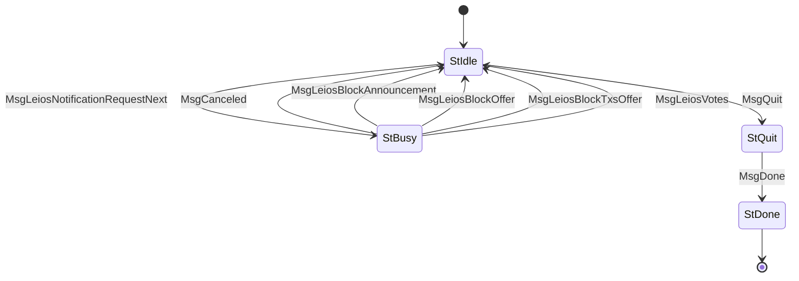

# LeiosNotify (Protocol ID 18) — CIP-0164

Client-driven polling for Leios data announcements. Server notifies the client about available endorser blocks (EBs), EB transactions, and votes. The client uses these offers to decide what to fetch via [LeiosFetch](../leios_fetch/). Votes are delivered inline.

The codec follows `encodeLeiosNotify` / `decodeLeiosNotify` in [ouroboros-consensus c54515e](https://github.com/IntersectMBO/ouroboros-consensus/blob/c54515e35498e921cbd651a2c19c3360a41d35b8/ouroboros-consensus/src/ouroboros-consensus/LeiosDemoOnlyTestNotify.hs).

## Files

| File | Description |
|------|-------------|
| `mod.rs` | State machine (`State`, `Message`), `Protocol` impl, `LeiosNotifyEvent` helper enum |
| `codec.rs` | CBOR encode/decode for LeiosNotify messages |

**Legend:** CBOR = Concise Binary Object Representation; impl = implementation.

## State Machine

## Agency Table

| State | Agency | Message | Next State |
|-------|--------|---------|------------|
| StIdle | **Client** | MsgLeiosNotificationRequestNext | StBusy |
| StIdle | **Client** | MsgQuit | StQuit |
| StQuit | **Server** | MsgDone | StDone |
| StBusy | **Server** | MsgCanceled | StIdle |
| StBusy | **Server** | MsgLeiosBlockAnnouncement(header) | StIdle |
| StBusy | **Server** | MsgLeiosBlockOffer(point, eb_size) | StIdle |
| StBusy | **Server** | MsgLeiosBlockTxsOffer(point) | StIdle |
| StBusy | **Server** | MsgLeiosVotes(votes) | StIdle |
| StDone | Nobody | — | — |

**Legend:** Agency = the side allowed to send the next message; `St` and `Msg` are the state and message prefixes used in the Rust enums. `point` identifies an endorser block by slot and hash; `eb_size` is its offered byte size; `header` is a ranking-block header; `votes` is a list of votes delivered inline.

## Wire Format

| Message | CBOR array |
|---------|------------|
| MsgDone | `[0]` |
| MsgQuit | `[1]` |
| MsgCanceled | `[2]` |
| MsgLeiosNotificationRequestNext | `[3]` |
| MsgLeiosBlockAnnouncement | `[4, header]` |
| MsgLeiosBlockOffer | `[5, point, eb_size]` |
| MsgLeiosBlockTxsOffer | `[6, point]` |
| MsgLeiosVotes | `[7, votes]` |

**Legend:** CBOR = Concise Binary Object Representation; `point` = `[slot, hash32]`, where `hash32` is a 32-byte hash; `header` is a ranking-block header; `eb_size` is the offered endorser-block byte size. Each entry in `votes` is `[announcing_ranking_block_hash, voter_id, signature]`, identifying the announcing block, voter, and vote signature.

Tests use byte vectors derived from the Haskell encoder and captured payloads combined with explicit message tags.

## Limits

- **Max message size**: 65,535 bytes
- **Ingress limit**: 65,536 bytes
- **Max votes per message**: 1,024
- **Timeout**: untimed notification long poll; shutdown has one 120-second deadline covering outstanding replies and the server acknowledgement
- **Client request pipeline**: 100 outstanding requests, replenished before event delivery. This keeps credits available for notification bursts; the reference server can drop notifications when credits run out. The serial helper remains available for one-shot protocol clients.

## Messages

- **MsgLeiosBlockAnnouncement** — ranking-block (RB) header that announces an EB (carries the EB hash in the CIP-0164 header extension)
- **MsgLeiosBlockOffer** — an EB is available for fetching (`point` and `eb_size`)
- **MsgLeiosBlockTxsOffer** — an EB's transactions are available (`point`)
- **MsgLeiosVotes** — a batch of votes delivered inline, each containing the announcing RB hash, voter identifier, and signature

## Client Helpers

- `request_next(runner) -> Result<LeiosNotifyEvent, ProtocolError>` — poll for the next notification. On `MsgCanceled`, complete the `MsgQuit`/`MsgDone` exchange and return `ProtocolError::Terminated`.
- `LeiosNotifyEvent` enum: `BlockAnnouncement`, `BlockOffer`, `BlockTxsOffer`, `Votes`
- `done(runner) -> Result<(), ProtocolError>` — send `MsgQuit` and wait for `MsgDone`.

The runner helpers are non-pipelined; they do not send a concurrent `MsgQuit` while a request is outstanding.

The production peer task uses `PipelinedClient::next()`. Its `shutdown()` sends
`MsgQuit` once, stops replenishing requests, and drains one notification or
`MsgCanceled` for each outstanding request before accepting `MsgDone`. Notifications
already in flight are discarded during draining. A cancellation received by
`next()` also starts this shutdown and returns `ProtocolError::Terminated` after
completion. Calling `shutdown()` again neither repeats Quit nor resets its deadline.
The production peer task does not initiate shutdown: unsolicited cancellation is
reported to the coordinator as a peer failure after the handshake completes, so
the connection is torn down and can reconnect instead of silently losing its
notification stream.

## Server

`serve_leios_notify` accepts up to 1,000 outstanding notification requests.
It reads incoming requests while waiting for data. On `MsgQuit`, it replies
with one `MsgCanceled` per unanswered request, then `MsgDone`.

The responder sends a matching announcement on this connection before each
block's first body or transaction offer. It records delivery after a successful
send to the ordered mux queue. An inbound announcement, a skipped entry, or a
prepared response does not count as sent.

The store retains original ranking-block headers indexed by the slot and
announced endorser-block hash, independently of the notification cursor. This
lets a retried offer supply an announcement missed during disconnection or
filtered by no-echo. Dependency replay may send the header back to its source
when an otherwise eligible offer requires it; body/transaction source filtering
still applies. Received headers enter this cache through the coordinator.
Identical headers coalesce to prevent relay loops; distinct equivocation headers
remain distinct.

Offers whose headers are unavailable are coalesced and deferred while unrelated
notifications continue. Deferred offers are reconsidered on store or control
changes and after each send; evicted bodies are not advertised. Body and
transaction offers have independent per-connection sent histories, so retries
reach new connections without repeating offers on existing ones.

All connection history expires with the store's retention window, including on
idle connections. Each connection retains at most 10,000 block records (with at
most one pending body and one pending transaction offer each) and 10,000 header
identities. At capacity it terminates instead of forgetting live sent history.
The replay cache is separately bounded to 10,000 headers and 16 MiB of raw header
bytes; cache eviction leaves dependent offers deferred until a header returns or
the offer expires.

Outbound controls still apply at delivery: `echo_to_source` opens the no-echo
gate, and `offer_eb_size` rewrites the offered size. The explicit adversarial
`withhold_announce` control permits unannounced **locally produced** offers only;
it never counts a withheld announcement as sent or bypasses ordering for relays.
